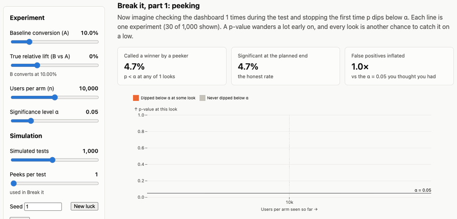

# data-concepts

An interactive site for learning data, analytics, ML, AI and software engineering concepts through
visual explanations, simulations you can break on purpose, and real queries on cloud platforms.
See [PLAN.md](PLAN.md) for the design notes and history.



## What's inside

- **48 modules in 9 tracks**, each laid out as:
  1. **Understand:** the plain-language explanation, first.
  2. **Lab:** live controls and charts (simulations in TypeScript, SQL on DuckDB-WASM in the browser).
  3. **Experiments:** numbered “break it on purpose” challenges; *Set it up* configures the lab, then
     what to look for and why it happens.
  4. **Deep dive:** the mechanism step by step (steppers and diagrams), formulas, tables, production notes.
  5. **Interview:** real-style questions with model answers and what a strong answer includes.
  6. **Check yourself:** short questions with reference answers.
- **Progress tracking** per login: experiments set up, interview questions answered, checks done, a
  streak calendar and progress by track and by role on the home page.
- **Roles page:** what data analyst, analytics engineer, data engineer, data scientist, ML engineer,
  AI engineer, software engineer and data manager roles ask for (from job-post data), mapped to modules.
- **Cloud platforms page:** AWS, Google Cloud, Azure, Snowflake and Databricks compared service by
  service, with a pipeline map, head-to-head dimensions and a cost explorer.
- **Integrations:** guided labs and a SQL console on real BigQuery, Snowflake, Athena and Databricks
  accounts, with server-held credentials and spending caps (see below).

| Track | Module | Route |
|---|---|---|
| Statistics | Central limit theorem | `/clt` |
|  | Confidence intervals | `/confidence-intervals` |
|  | The bootstrap | `/bootstrap` |
|  | Simpson’s paradox | `/simpsons-paradox` |
|  | Regression to the mean | `/regression-to-the-mean` |
| Experimentation | A/B testing | `/ab-testing` |
|  | Multiple comparisons | `/multiple-comparisons` |
|  | Sample ratio mismatch | `/sample-ratio-mismatch` |
|  | CUPED | `/cuped` |
|  | When you can't randomise: difference-in-differences | `/difference-in-differences` |
|  | Marketplace experiments: interference and switchbacks | `/switchback` |
| Analytics engineering | Grain and join fan-out | `/join-fanout` |
|  | Window functions | `/window-functions` |
|  | Surrogate keys | `/surrogate-keys` |
|  | Dimensional modelling | `/dimensional-modeling` |
|  | Data quality and contracts | `/data-quality` |
|  | dbt in practice | `/dbt` |
| Data engineering | Snapshots and incremental loads | `/snapshots` |
|  | Retries and idempotency | `/retries-idempotency` |
|  | Late data and watermarks | `/late-data` |
|  | Partitioning | `/partitioning` |
|  | Orchestration, backfills and SLAs | `/orchestration` |
|  | Kafka, partitions and consumer lag | `/kafka` |
|  | Spark joins, shuffles and skew | `/spark-joins` |
|  | Lakehouse tables (Delta, Iceberg) | `/lakehouse` |
|  | System design: surge pricing | `/surge-pricing` |
| Data analysis | Cohorts and retention | `/cohorts` |
|  | Funnels | `/funnels` |
|  | Trend vs seasonality | `/trend-seasonality` |
|  | KPI trees and explaining a metric change | `/metric-trees` |
| Machine learning | Bias vs variance | `/bias-variance` |
|  | Train/test leakage | `/leakage` |
|  | Gradient descent | `/gradient-descent` |
|  | ROC curves and thresholds | `/roc-thresholds` |
|  | Class imbalance | `/class-imbalance` |
|  | Monitoring models in production (drift) | `/drift` |
| AI engineering | RAG: chunking and retrieval | `/rag` |
|  | Embeddings and vector search | `/embeddings` |
|  | LLM evals | `/llm-evals` |
|  | Agents and tool use | `/agents` |
|  | LLM cost and latency | `/llm-cost` |
| Software engineering | Queues and Little’s law | `/queues` |
|  | Tail latency and fan-out | `/tail-latency` |
|  | Caching | `/caching` |
|  | Rate limiting and retries | `/rate-limiting` |
| Data leadership | SLOs and error budgets for data | `/slos` |
|  | Prioritising with cost of delay | `/prioritisation` |
|  | Build vs buy | `/build-vs-buy` |

Every simulation is checked against theory or known numbers in tests (e.g. with no effect ~5% of simulated
A/B tests are significant; AUC matches Φ(d/√2); the DiD estimate recovers the true effect under parallel
trends; Kafka lag grows by exactly the capacity gap). SQL modules run the same queries on DuckDB-WASM in the
browser and on native DuckDB in the tests. Each experiment's claimed numbers are verified before they go
into the content.

## Architecture

- **Web** (`src/`): Vite + React + TypeScript, Observable Plot and D3 for charts, DuckDB-WASM for SQL labs.
  Labs are code (`src/modules/<slug>/`, registered in `src/modules/labs.ts`); everything else comes from
  the content API.
- **Content** (`content/`): modules, tracks, roles, job-market data, the cloud-platform catalogue and the
  integration guides, written as YAML. The API validates it (pydantic) and builds a read-only SQLite
  database with full-text search; invalid content fails the build.
- **API** (`api/`): FastAPI. Serves content, stores progress per login in a writable SQLite database, and
  runs integration queries.

## Integrations

Each provider has a setup guide (on its integration page) for a least-privilege key, then:

```sh
./deploy/set-integration.sh bigquery  ~/Downloads/key.json        # service-account key as downloaded
./deploy/set-integration.sh snowflake snowflake.json rsa_key.p8   # config + key-pair private key
./deploy/set-integration.sh athena    athena.json
./deploy/set-integration.sh databricks databricks.json
./deploy/set-integration.sh athena --remove
```

The script sends the config over SSH to `/opt/data-concepts/secrets/` (root-only, mounted read-only into
the API container) and runs a test query. Keys never enter the repository or the browser. Guard rails:
provider-side caps (BigQuery maximum bytes billed, a Snowflake resource monitor, the Athena workgroup scan
limit, Databricks auto-stop), app limits (200 queries and 20 GB per provider per day, 60 s timeout, 500
rows, one statement at a time) and an audit log of every query.

## Develop

```sh
npm install
npm run api         # content API on :8787 (reseeds and reloads on content/ changes)
npm run dev         # web on http://localhost:5173, proxies /api to :8787
npm test            # web unit tests (Vitest)
npm run api:test    # API tests (pytest)
npm run typecheck
npm run lint
npm run seed        # rebuild the content database once
```

## Deploy

Live at <https://data-concepts.srv1294517.hstgr.cloud> (private: basic auth).

```sh
./deploy/deploy.sh   # test, build, ship to jobz-vps, build both images there, roll out the stack
```

A Docker Swarm stack (`deploy/stack.yml`) with two services behind the Traefik already on the VPS:
`web` (Caddy serving `dist/`) and `api` (FastAPI, routed on `/api`). Both use the same basic-auth login.
Progress lives on the `progress` volume; integration credentials in `/opt/data-concepts/secrets`. The
first deploy creates the login (`/opt/data-concepts/.env`, a hash only) and prints the password once; to
change it, delete that file and redeploy.

## Layout

- `src/core/`: pure, unit-tested logic (statistics, simulations, SQL builders behind a `Db` interface)
- `src/modules/<slug>/`: one lab per module, built on `ModuleLayout`
- `src/visuals/`: figures used by content (steppers, diagrams), registered by key
- `src/components/`, `src/pages/`, `src/lib/`: shared UI, pages, API client, progress store, DuckDB-WASM
- `content/`: all text and data, as YAML
- `api/app/`: content API, progress, integrations (`integrations/providers.py` has one adapter per provider)
- `tests/`, `api/tests/`: tests
- `deploy/`: Dockerfiles, Caddy config, stack, deploy and set-integration scripts
